<!-- ───────────────────────────── HERO ───────────────────────────── -->

 

<a href="#01-about">About</a> ·
<a href="#02-tech-stack">Stack</a> ·
<a href="#03-experience">Experience</a> ·
<a href="#04-featured-projects">Projects</a> ·
<a href="#05-ai--agents">AI</a> ·
<a href="#06-cloud--security">Cloud &amp; Security</a> ·
<a href="#07-github-activity">Activity</a> ·
<a href="#08-goals--community">Goals</a> ·
<a href="#09-contact">Contact</a>

 

> [!TIP]
> **Recruiter TL;DR:** Full Stack Developer (React · Next.js · TypeScript · Python/FastAPI · PostgreSQL) who also builds **tool-calling AI agents**. Delivered an end-to-end **ERP/MES platform** with REST API and MQTT integration as a final-year intern, then a **freelance** task-management platform for a client in Germany. Now in an **Engineering Cycle in Cloud Computing & Networks**. **Open to junior Full Stack Developer roles.**

## `01` About

I'm a Full Stack Developer from Tunisia who likes owning a product from the first requirements meeting to the last passing test. My main stack is **React, Next.js and TypeScript** on the front end and **Python/FastAPI with PostgreSQL** on the back end, and I design and integrate the REST APIs that tie them together.

I also **build with AI**: I design AI agents, agent skills and dynamic agentic workflows, and I use AI-assisted development in my daily work. I'm curious and self-driven, at ease in **Agile Scrum** teams, and comfortable with requirements gathering, product ownership and talking to stakeholders.

<table>
<tr>
<td width="25%" valign="top">

**🎓 Studying** 
Engineering Cycle in Cloud Computing &amp; Networks · EPI Digital School

</td>
<td width="25%" valign="top">

**🛠️ Latest build** 
<a href="https://github.com/afefbenkalia/Sanefli-AI-Powered-Recipe-Platform">Sanefli</a>, a recipe platform with an AI Chef agent

</td>
<td width="25%" valign="top">

**🏆 Recognition** 
1st prize, “Best Innovative Project Idea” hackathon

</td>
<td width="25%" valign="top">

**🎯 Looking for** 
A junior Full Stack Developer role

</td>
</tr>
</table>

## `02` Tech Stack

<table>
<tr>
<td width="22%" valign="top"><b>🧠 AI &amp; Agents</b></td>
<td>AI agents · agent skills · dynamic AI workflows · LLM tool calling · AI-assisted development</td>
</tr>
<tr>
<td valign="top"><b>⚡ Main stack</b></td>
<td>

 
React · Next.js · TypeScript · JavaScript · Tailwind CSS · Python · FastAPI · REST APIs · PostgreSQL · Prisma ORM

</td>
</tr>
<tr>
<td valign="top"><b>🧰 Tools &amp; practices</b></td>
<td>

 
Git · GitHub · Docker · Linux · Figma · VS Code · IntelliJ IDEA · MQTT · UML · Agile (Scrum)

</td>
</tr>
</table>

<b>🔍 Also familiar with</b> (click to expand)

 

 

| Area | Technologies |
|---|---|
| Back end &amp; frameworks | PHP/Laravel · Java/Spring Boot · ASP.NET MVC · Node.js |
| Mobile | Flutter · Android Studio |
| Languages | C |
| Databases | MySQL · MongoDB · SQL Server · Oracle · SQLite |

<b>🤝 Professional skills</b>

 

Cross-functional teamwork · product ownership · requirements gathering · stakeholder communication · problem solving · adaptability · continuous learning · time management

## `03` Experience

<b>Freelance Full Stack Developer</b> · Task Management Web Application · <i>Remote, Germany</i> · <code>Aug 2026 – Sep 2026</code>

 

- Designed and built a full-stack **task management platform** with **React** and **FastAPI**, turning the client's requirements into working features.
- Implemented task workflows, user management, **role-based access control** and admin features, delivering **100% of the agreed core requirements**.
- Used **Claude Code** for AI-assisted debugging, refactoring and problem-solving throughout development.

<b>Full Stack Developer, End-of-Studies Internship (PFE)</b> · YOHATECH · <i>Monastir, Tunisia</i> · <code>Feb 2026 – May 2026</code>

 

- Designed and built a full-stack **ERP/MES platform** for industrial production management and monitoring (**React, Tailwind CSS, FastAPI, PostgreSQL**).
- Integrated the ERP and MES through a **REST API** and ingested machine data over the **MQTT** protocol.
- Delivered **six core modules**: user management, production tracking, inventory, machine maintenance, supplier orders and reporting.
- Analyzed requirements and modeled the system in **UML**, delivering in an **Agile Scrum** workflow.

<b>Web Developer Intern</b> · WavyLab · <i>Sousse, Tunisia</i> · <code>Jan 2025 – Feb 2025</code>

 

- Built **“Blogger”**, a dynamic blog platform, with **Next.js, MongoDB and Prisma**, with social login (Google, Facebook, Twitter) through **NextAuth**.
- Designed user-centered UI/UX mockups in **Figma**, and diagnosed and fixed authentication and display issues.

<b>Web Developer Intern</b> · Leoni · <i>Monastir, Tunisia</i> · <code>Jan 2024 – Feb 2024</code>

 

- Contributed front-end and back-end features to an e-commerce website with **ASP.NET MVC** in a professional environment.
- Queried and analyzed data in **Microsoft SQL Server**, strengthening my web architecture, OOP and database integration skills.

<b>🎓 Education</b>

 

| Program | School | Years |
|---|---|---|
| Engineering Cycle in **Cloud Computing and Networks** | EPI Digital School, Sousse | 2026 – present |
| Bachelor's Degree (Licence) in **Information Systems Development** | ISET Kairouan | 2023 – 2026 |

## `04` Featured Projects

### 🍳 Sanefli: AI-Powered Recipe Platform

Tell Sanefli what's in your kitchen and it ranks the recipes you can cook, with a **match percentage** and the **missing ingredients** for each one. Signed-in users can also chat with **Chef IA**, an AI agent that suggests recipes, explains the steps and proposes **ingredient substitutions** based on the real recipe and pantry data.

- **Matching engine:** match % per recipe, “almost ready” recipes missing only one or two ingredients, and filters by category, difficulty and time.
- **Personal kitchen:** pantry, auto-generated shopping lists, favorites, ratings, reviews, search history and a role-based **admin dashboard**.
- **AI Chef agent:** Python, FastAPI and Groq LLM tool calling across six tools, capped at five model calls per message.
- **Secure by design:** service authentication, encrypted short-lived user tokens and per-user rate limiting between Laravel and the agent.
- **Tested:** **140+ automated tests** (98 PHPUnit + 44 Python `unittest`). The agent suite uses a scripted model and a fake API, so it runs with no network.

<b>📸 See it in action</b> (screenshots from the repository)

 

| Ingredient picker | Live suggestions |
|---|---|
|  |  |
| **Shopping list** | **Admin: users &amp; roles** |
|  |  |

<a href="https://github.com/afefbenkalia/Sanefli-AI-Powered-Recipe-Platform"><b>Explore the repository →</b></a>

### 🏭 ERP / MES Platform for Industrial Production

My end-of-studies project at **YOHATECH**: a platform that follows production from the machines on the shop floor to the management dashboards. The **MES** collects machine data over **MQTT** and covers production, orders, machines, downtime, OEE and traceability. The **ERP** manages stock and production, with purchases, sales and HR views, and the two systems talk over a **REST API**. I modeled the system in **UML** and delivered it in **Agile Scrum** sprints.

<a href="https://github.com/afefbenkalia/mes-project"><b>MES repository →</b></a> &nbsp; <a href="https://github.com/afefbenkalia/erp-projet"><b>ERP repository →</b></a>

### 🧩 More featured builds

<table>
<tr>
<td width="50%" valign="top">

Kanban board, calendar, file sharing, comments, notifications, Ctrl+K global search and a full <b>audit log</b>, backed by pytest and Vitest suites.
</td>
<td width="50%" valign="top">

Automatic payslip calculation (gross, deductions, net), amounts written out in words, and <b>Tesseract.js OCR</b> that reads a bank RIB from an image.
</td>
</tr>
</table>

<b>📂 Earlier work</b>

 

| Project | What it is | Stack |
|---|---|---|
| [**blog_app1**](https://github.com/afefbenkalia/blog_app1) | Dynamic blog platform | Next.js · MongoDB · Tailwind CSS |
| [**Travel-Agency-**](https://github.com/afefbenkalia/Travel-Agency-) | “AirTravel” travel agency website | HTML · CSS |

## `05` AI & Agents

> I don't just call an LLM. I design the system around it: what it's allowed to see, which tools it can use, and how it fails safely.

| Principle | How I apply it |
|---|---|
| 🧭 **Business logic stays in the app** | In Sanefli, the agent's tools call an internal Laravel API that reuses the same matching engine as the website. The agent never connects to the database. |
| 🔁 **Bounded agent loops** | The model chooses among six tools, the agent runs them and feeds the results back, and the loop stops after five model calls per message. |
| 🔌 **Provider-agnostic** | Works with any OpenAI-compatible chat API that supports tool calling. Groq is the default. |
| 🛡️ **Untrusted model output** | The agent returns recipe IDs only, Laravel builds the recipe cards from the database, and model text is HTML-escaped before display. |
| 🧪 **Testable without a network** | The agent suite runs on a scripted model and a fake API, so no API key is needed. |
| 🤖 **AI-assisted engineering** | I use Claude Code day to day for debugging, refactoring and problem-solving, as I did on my freelance project. |

## `06` Cloud & Security

I'm in an **Engineering Cycle in Cloud Computing and Networks** at EPI Digital School, building on a foundation of **Docker, Linux, MQTT** and API design. On the security side, these are the controls I've already **implemented and tested in my own code**:

| Security control | Where |
|---|---|
| Short-lived JWT access tokens kept in memory, and **rotating refresh tokens** in `httpOnly` cookies | TaskFlow |
| **Token-family revocation** when a revoked refresh token is reused | TaskFlow |
| Only **SHA-256 hashes** of refresh and password-reset tokens are stored | TaskFlow |
| **RBAC** enforced on the backend for every request, with **404s** that don't reveal projects a user can't access | TaskFlow |
| Full **audit log** of admin activity and access denials | TaskFlow |
| Shared service key compared in **constant time**, plus **encrypted 3-minute user tokens** | Sanefli |
| **Per-user rate limiting**, session auth and CSRF protection on the chat endpoint | Sanefli |
| Password hashing with **bcrypt** and account approval workflows | TaskFlow · Payment Management |

## `07` GitHub Activity

<picture>
  <source media="(prefers-color-scheme: dark)" srcset="https://raw.githubusercontent.com/afefbenkalia/afefbenkalia/output/github-contribution-grid-snake-dark.svg" />
  <source media="(prefers-color-scheme: light)" srcset="https://raw.githubusercontent.com/afefbenkalia/afefbenkalia/output/github-contribution-grid-snake.svg" />
  
</picture>

## `08` Goals & Community

<table>
<tr>
<td width="50%" valign="top">

#### 🎯 Where I'm heading
- Join a product team as a **junior Full Stack Developer** and ship features end to end.
- Grow in **cloud computing and networks** through my engineering cycle, and bring that knowledge to how I deploy and scale applications.
- Keep building **AI agents** that are useful, bounded and secure.
- Keep learning so I keep pace with the evolving AI tooling ecosystem.

</td>
<td width="50%" valign="top">

#### 🏅 Achievements &amp; community
- 🥇 **1st prize**, “Best Innovative Project Idea” hackathon
- 🥈 **2nd prize**, Coding Day ISET Kairouan (Python game)
- 💻 **IEEE Xtreme 19.0** participant
- 🌐 **Webmaster**, IEEE Student Branch ISET Kairouan (2024 – 2026): maintained and updated the branch website, fixed issues and supported members
- 🗣️ Arabic (native) · French (intermediate) · English (intermediate)

</td>
</tr>
</table>

## `09` Contact

**Have a role, a project or an idea in mind? I'd love to hear about it.**

  

